# Technical Malware Analysis Report: TinyTurla-NG (Turla) Service DLL Backdoor

## Sample Identification & Metadata

* **Original File Name:** `sample.dll` / `out.dll`
* **Exported Entry Point:** `ServiceMain` (Ordinal 1, RVA: `0xDCE0`)
* **File Type:** PE32+ Executable (DLL) x86-64
* **SHA-256:** `d6ac21a409f35a80ba9ccfe58ae1ae32883e44ecc724e4ae8289e7465ab2cf40`
* **MD5:** `f3d9a184e27161ab89382f1bc20a321d`
* **File Size:** 285.00 KB (291,840 bytes)
* **Compiler / Toolchain:** Microsoft Visual C/C++ (19.28.30038) / Visual Studio 2019
* **Malware Family / Threat Actor:** TinyTurla-NG / Turla (the SHA-256 is listed in the IOCs of the Cisco Talos report "TinyTurla Next Generation", 15 February 2024)
* **Solver:** DeepDominance

> **Revision (2026-11-06).** Corrected after a static re-check: the C2 URLs are stored in plain text (not decrypted at run time), the `IsDebuggerPresent` block is MSVC runtime code (`__scrt_fastfail`), not anti-debugging, and the YARA rule no longer relies on that runtime pattern. Network indicators are defanged.

---

## Executive Summary

This report provides a reverse engineering analysis of a 64-bit Windows DLL backdoor of the TinyTurla-NG family, attributed by Cisco Talos to the Turla APT group. To evade detection and maintain persistence, the binary masquerades as a legitimate Windows Service executing via the exported entry point `ServiceMain`.

During analysis, binary patching techniques were utilized within IDA Pro to neutralize the Service Control Manager (SCM) checks in `ServiceMain`, so that the DLL could run under `rundll32.exe`. This allowed successful dynamic profiling in x64dbg and Sysinternals Process Monitor (Procmon), uncovering dual-C2 infrastructure (a primary domain and a fallback backup C2) on compromised WordPress sites (URLs stored in plain text), a hardcoded bot identifier, and system locale/shell directory reconnaissance.

---

## Binary Technical Specifications

* **Architecture:** PE32+ (64-bit Dynamic Link Library)
* **Subsystem:** Windows GUI / Console Service
* **Primary Capabilities:** Service Masquerading, Anti-Analysis/Anti-Debugging, System Reconnaissance, Encrypted WinHTTP C2 Communication, C2 Redundancy/Fallback, Dynamic String Decryption
* **Toolchain Used:** Detect It Easy (DIE), PE-bear, IDA Pro (v7.x/v8.x), x64dbg, Process Monitor (Sysinternals), FakeNet-NG

---

## Technical Walkthrough

### 1. Static Triage & Import Inspection

Initial static inspection using **Detect It Easy (DIE)** and **PE-bear** yielded key structural characteristics:

* **Entropy & Packing Analysis:**
  * Overall File Entropy: **`6.31812`** (`not packed 78%`).
  * `.text` Code Section Entropy: **`6.45664`**.
  * *Verdict:* The binary is not compressed or obfuscated by an external runtime packer (e.g., UPX, Themida). The executable code is exposed in plain x64 Assembly.

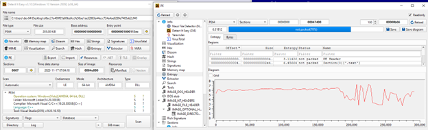

* **Export Address Table (EAT) & Import Address Table (IAT) Inspection:**
  * **EAT:** Contains a single export: Ordinal 1 at RVA `0xDCE0` named **`ServiceMain`**.
  * **`ADVAPI32.dll`:** Service management (`RegisterServiceCtrlHandlerW`, `SetServiceStatus`) and Registry queries (`RegOpenKeyExA`, `RegQueryValueExA`).
  * **`KERNEL32.dll`:** Memory management, process initialization, and runtime support (`IsDebuggerPresent` and `SetUnhandledExceptionFilter` are used by the MSVC runtime, see section 3; `CreateProcessA/W`, `VirtualAlloc`).
  * **`WINHTTP.dll`:** HTTP client routines (`WinHttpOpen`, `WinHttpConnect`, `WinHttpSendRequest`, `WinHttpReadData`).

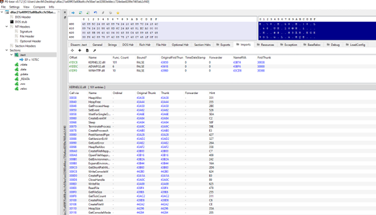
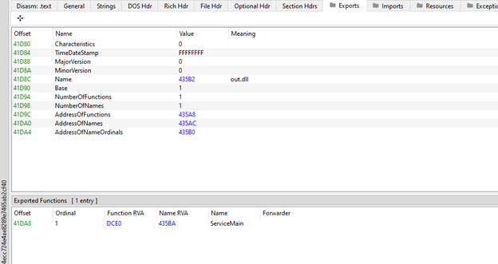
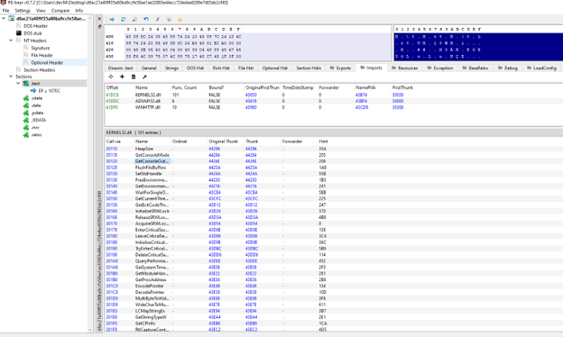

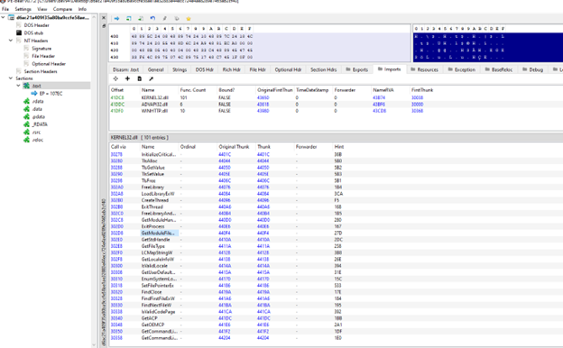
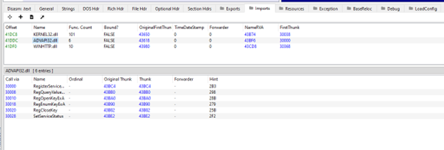
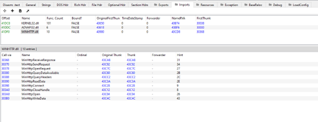
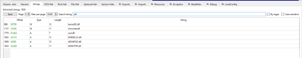
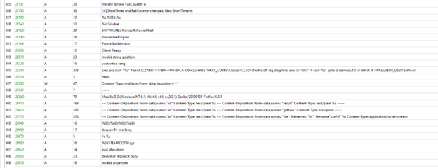

---

### 2. Service Execution Logic & Anti-Service Patching (`ServiceMain`)

Disassembly of `ServiceMain` (RVA: `0xDCE0`) in IDA Pro revealed that the malware immediately invokes `RegisterServiceCtrlHandlerW`.

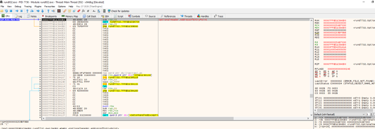

1. **SCM Execution Constraint:** When executed outside a legitimate service context (e.g., via `rundll32.exe sample.dll, ServiceMain`), the SCM pipe handler returns `0` (`NULL`).
2. **Conditional Branching:** Following the API call, a `test rax, rax` instruction combined with `jz loc_18000DDB6` immediately routes execution to a termination block.

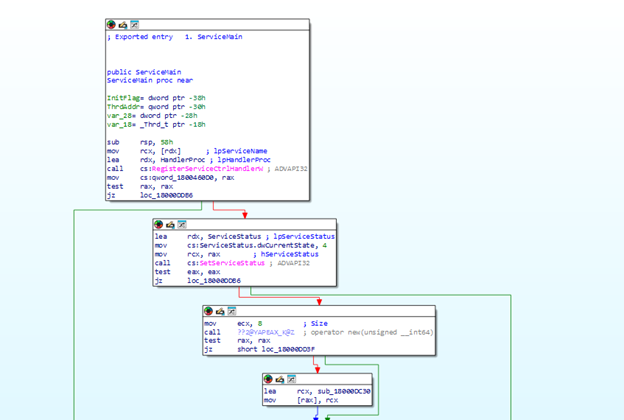

3. **Binary Patching Solution:**
   * The original 6-byte Near Jump instruction `0F 84 B2 00 00 00` (`jz loc_18000DDB6`) was patched with six **`NOP` (`0x90 0x90 0x90 0x90 0x90 0x90`)** opcodes.
   * A subsequent `jz` branch following `SetServiceStatus` was similarly replaced with `NOP` instructions.

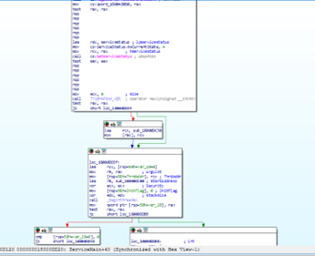

4. **Result:** Despite SCM registration failure, the processor ignores the error status and proceeds directly into the primary operational payload subroutine (`sub_18000DC30`).

---

### 3. The `IsDebuggerPresent` Block (MSVC Runtime, Not Anti-Debugging)

At `0x1800116EC` the DLL calls `IsDebuggerPresent`, compares the result with 1, calls `SetUnhandledExceptionFilter(NULL)` and `UnhandledExceptionFilter`, and then tests both results (`jnz` at `0x180011720` and `0x180011724`). This sequence is the MSVC C runtime function `__scrt_fastfail`: it runs only when the process fails fast (for example, after stack corruption) and hands control to an attached debugger. It is present in almost every MSVC-built binary and is not an anti-debugging technique of the malware.

In the analysed copy (`sample.dll`) the two `jnz` instructions were replaced with `NOP`s. A byte diff against the original file shows four patched locations in total:

| VA | Original | Patched | Purpose |
| :--- | :--- | :--- | :--- |
| `0x18000DCFE` | `0F 84 B2 00 00 00` (`jz`) | `90 × 6` | continue after `RegisterServiceCtrlHandlerW` fails |
| `0x18000DD20` | `0F 84 90 00 00 00` (`jz`) | `90 × 6` | continue after `SetServiceStatus` fails |
| `0x180011720` | `75 0C` (`jnz`) | `90 90` | CRT `__scrt_fastfail`, no effect on normal execution |
| `0x180011724` | `75 08` (`jnz`) | `90 90` | CRT `__scrt_fastfail`, no effect on normal execution |

Only the first two patches are needed to run the service DLL outside the SCM. An alternative that needs no patching is to register the DLL as a service in the analysis VM.

---

### 4. Dynamic Profiling & C2 Infrastructure Extraction (x64dbg)

Following static patching, the binary was dynamically analyzed in **x64dbg** by placing hardware breakpoints on `WinHttpConnect` and `WinHttpSendRequest`.

#### A. Primary C2 Resolution
The full C2 URLs are stored in plain text in `.rdata` and are visible with `strings` (`https://jeepcarlease[.]com/wp-includes/blocks/rss.old.php`, `https://caduff-sa[.]ch/wordpress/wp-includes/rss.old.php`). At run time the host name is passed to `WinHttpConnect` in the `pswzServerName` argument. Inspection of the registers at `WinHttpConnect` confirmed the primary C2:

* **Primary C2 Server:**
  * **Domain:** `jeepcarlease[.]com`
  * **URI Path:** `/wp-includes/blocks/rss.old.php`
  * **Port / Protocol:** `443` (HTTPS / `0x1BB` in `R8D` register)
  * **HTTP Method:** `POST` (`R14` register)

![Figure 15: x64dbg WinHttpConnect Breakpoint - Primary C2 jeepcarlease[.]com Resolution](images/15.png)

#### B. Bot Identity & HTTP Payload Inspection
Intercepting execution at `WinHttpSendRequest` allowed examination of the POST body buffers pointed to by registers `RSI` and `RDX`:

* **Content-Type:** `multipart/form-data; boundary="\-"`
* **Hardcoded Bot ID / Campaign Key:** `307b5c9accde43a8aff50620c25cd089`
* **Exfiltration Structure:** `Content-Disposition: form-data; name="id"` containing the 32-character hexadecimal victim identifier string.

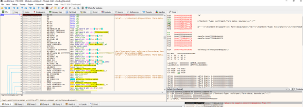

#### C. Secondary C2 Failover Resolution
Tracing execution revealed a C2 redundancy/failover mechanism:

* **Secondary (Fallback) C2 Server:**
  * **Domain:** `caduff-sa[.]ch`
  * **URI Path:** `/wordpress/wp-includes/rss.old.php`
  * **Port / Protocol:** `443` (HTTPS / `0x1BB`)
  * **HTTP Method:** `POST`

![Figure 17: x64dbg WinHttpConnect Breakpoint - Secondary Fallback C2 caduff-sa[.]ch Resolution](images/17.png)

---

### 5. System Behavioral Analysis (Process Monitor Inspection)

Behavioral monitoring of `rundll32.exe` using **Sysinternals Process Monitor (Procmon)** identified key reconnaissance activity:

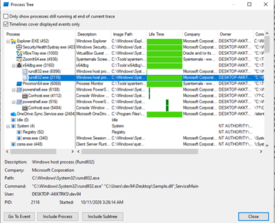

1. **Module & Image Loading:**
   * `rundll32.exe` loads `sample.dll` into memory space along with system dependencies.

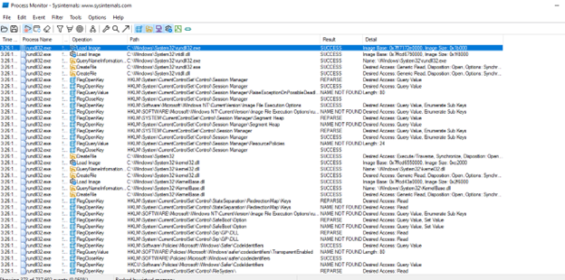
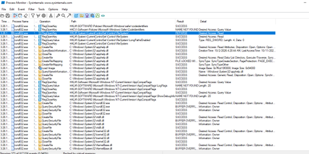

2. **Directory Reconnaissance & Dependencies:**
   * Resolves local user environment paths (`AppData`, `Local Temp`, and `Desktop`).
   * Loads `bcrypt.dll` (cryptographic operations), `advapi32.dll` (registry/service controls), and `combase.dll` / `rpcrt4.dll` (RPC inter-process communication).

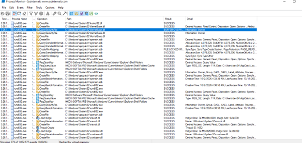
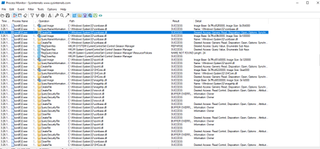
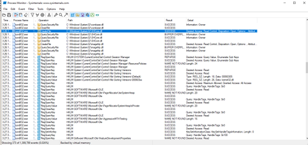

3. **Locale & Environment Profiling:**
   * Queries `HKCU\Control Panel\Desktop\MuiCached` returning `REG_MULTI_SZ` data `en-US`.
   * Queries `HKCU\SOFTWARE\Microsoft\Windows\CurrentVersion\Explorer\Shell Folders` to map host profile directory structures.

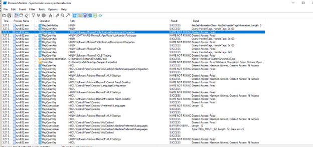

---

## Indicators of Compromise (IoCs)

### Cryptographic Hashes

| Asset / File | Hash Type | Value |
| :--- | :--- | :--- |
| `sample.dll` / `out.dll` | SHA-256 | `d6ac21a409f35a80ba9ccfe58ae1ae32883e44ecc724e4ae8289e7465ab2cf40` |
| `sample.dll` / `out.dll` | MD5 | `f3d9a184e27161ab89382f1bc20a321d` |

### Network Indicators

| Indicator Type | Details / Value |
| :--- | :--- |
| **Primary C2 Endpoint** | `jeepcarlease[.]com/wp-includes/blocks/rss.old.php` |
| **Secondary C2 Endpoint** | `caduff-sa[.]ch/wordpress/wp-includes/rss.old.php` |
| **Port / Protocol** | 443 / HTTPS |
| **HTTP Method** | POST |
| **Encapsulation** | `multipart/form-data` |
| **Hardcoded Bot ID Key** | `307b5c9accde43a8aff50620c25cd089` |

### Host & Registry Artifacts

* `HKCU\Control Panel\Desktop\MuiCached`
* `HKCU\SOFTWARE\Microsoft\Windows\CurrentVersion\Explorer\Shell Folders`

---

## Detection Signature (YARA)

```yara
rule TinyTurla_NG_ServiceDLL
{
    meta:
        description = "TinyTurla-NG service DLL (Turla), Cisco Talos, February 2024"
        author      = "DeepDominance"
        date        = "2026-11-06"
        reference   = "https://blog.talosintelligence.com/tinyturla-next-generation/"
        sample_sha256 = "d6ac21a409f35a80ba9ccfe58ae1ae32883e44ecc724e4ae8289e7465ab2cf40"

    strings:
        $exp  = "ServiceMain" ascii
        $uri1 = "/wp-includes/blocks/rss.old.php" ascii wide
        $uri2 = "/wordpress/wp-includes/rss.old.php" ascii wide
        $id   = "307b5c9accde43a8aff50620c25cd089" ascii wide
        $ua   = "Mozilla/5.0 (Windows NT 6.1; Win64; x64; rv:2.0.1) Gecko/20100101 Firefox/4.0.1" ascii wide
        $f1   = "Content-Disposition: form-data;name=\"gettask\"" ascii wide
        $f2   = "Content-Disposition: form-data;name=\"result\"" ascii wide

    condition:
        uint16(0) == 0x5A4D and $exp and
        (1 of ($uri*) or $id or (all of ($f*) and $ua))
}
```

Tested on the original sample and the patched copy (both match) and on 720 unrelated PE/ELF files (no matches).

### Note
* This repository and the contained technical write-up are strictly created for educational, academic, and cybersecurity research purposes. The reverse engineering analysis was conducted in an isolated laboratory environment to understand threat behavior and develop detection mechanisms (YARA). No malicious binaries are hosted in this repository.